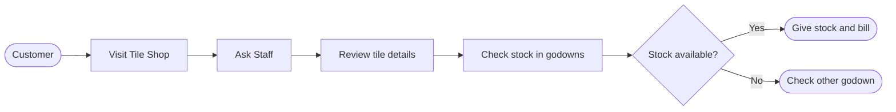
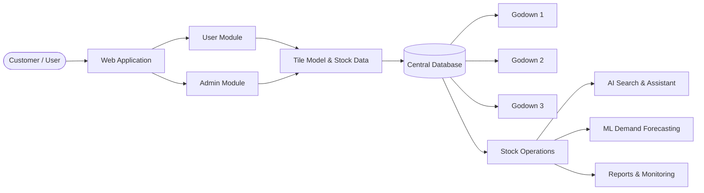
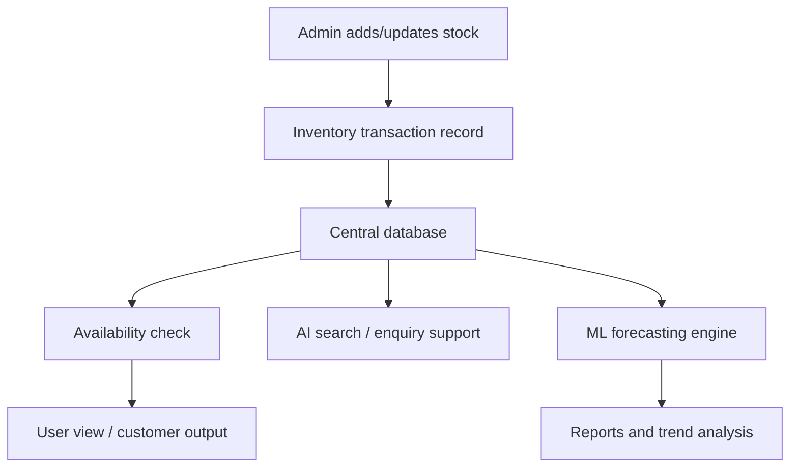

# SriSun Tiles
## Centralized Tile Inventory Management System

---

## 1. Project Overview

SriSun Tiles is a centralized inventory and enquiry management system designed to handle tile stock across multiple godowns. The system brings together product information, stock quantities, movement history, availability checks, and customer support into a single digital platform.

The project focuses on managing a catalog of 100 tile models across 3 storage locations while enabling faster search, better stock visibility, and future forecasting. The system includes user and admin modules, stock operations, AI-assisted search, and an ML-based demand prediction layer.

This documentation outlines the problem, proposed solution, system components, requirements, architecture, data model, and implementation roadmap.

---

## 2. Background and Business Need

SriSun Tiles currently operates using a fragmented process where stock is tracked across several godowns and customer requests are handled manually. In such a setup, staff may need to check multiple locations to confirm whether a specific tile model is available, and inventory movement between godowns may not be recorded consistently.

The business needs a centralized platform to:

- Maintain a master catalog of tile models
- Track real-time stock by godown
- Record stock additions, removals, and transfers
- Check availability quickly and accurately
- Support customer enquiries efficiently
- Improve decision-making with AI and ML-based insights

---

## 3. Problem Statement

Managing inventory across multiple godowns introduces several operational issues:

- Difficulty tracking exact stock quantity of each tile model
- Unclear stock location across Godown 1, 2, and 3
- Inconsistent availability checking
- Manual enquiry handling and slow customer support
- Lack of centralized data visibility for managers and staff
- Limited support for future demand planning and stock forecasting

The goal is to design and implement a centralized web-based system that improves inventory management, supports stock operations, and creates a path for AI-based assistance and data-driven forecasting.

---

## 4. Objectives of the System

The SriSun Tiles system aims to:

1. Create a centralized tile inventory database
2. Manage 100 tile models with unique IDs and detailed attributes
3. Track stock by godown and model
4. Support add, remove, and transfer stock operations
5. Provide search and availability checking
6. Support customer enquiries through an assistant interface
7. Use AI for natural-language tile search
8. Use ML for stock trend analysis and future demand prediction
9. Generate reports for stock monitoring and decision support

---

## 5. Scope

### 5.1 In Scope

- Tile model master data management
- Godown-wise stock tracking
- Inventory movement operations
- User and admin access
- Availability checking
- Customer inquiry support
- AI-based tile search
- ML-based stock/demand prediction
- Reporting and monitoring dashboard

### 5.2 Out of Scope

- Physical warehouse robotics or automation
- Advanced ERP integrations beyond the project scope
- Real-time IoT-based warehouse tracking
- Payment processing or billing integration
- Full-scale external supplier management

---

## 6. Existing Process and Limitations

The current system depends on manual checking of stock and model details across godowns. Staff typically ask for specifications such as tile model, colour, size, design, type, and price, then verify availability from one or more locations.

### 6.1 Existing Workflow

### 6.2 Limitations

- No centralized digital inventory record
- Manual stock checks are time consuming
- No single source of truth for stock availability
- Difficulty in monitoring all godowns simultaneously
- Limited data visibility for managers
- No automated assistance for customer enquiries
- No predictive models to anticipate demand

---

## 7. Proposed System Architecture

The proposed system is a web-based application that connects the user interface, business logic, database, AI services, and ML services. It will support both customer-facing and admin-facing workflows while centralizing all tile and stock data.

### 7.1 Main Components

**1. User / Customer**
- Searches for tiles
- Checks availability
- Sends enquiries

**2. Web Application**
- User module
- Admin module

**3. Tile Model Management**
- Model ID
- Colour
- Size
- Design
- Type
- Price

**4. Central Database**
- Product catalog
- Stock records
- Godown records
- Transaction history

**5. Godown Management**
- Godown 1
- Godown 2
- Godown 3

**6. Stock Operations**
- Add stock
- Remove stock
- Transfer stock
- Check availability

**7. AI Services**
- Natural language search
- Customer enquiry assistant

**8. ML Forecasting Module**
- Stock trend analysis
- Future demand prediction

**9. Reporting and Monitoring**
- Inventory summary
- Updates by godown
- Availability reports
- Analytics dashboards

### 7.2 High-Level Architecture Diagram

---

## 8. System Modules

### 8.1 User Module

This module allows users to browse tile models and check availability. It provides search and enquiry features to help customers find the right tile quickly.

### 8.2 Admin Module

This module allows administrators to manage tile catalog data, stock records, godown information, and inventory operations. It is responsible for data validation and stock updates.

### 8.3 Tile Model Management

Each tile model contains the following fields:

- Model ID
- Tile Model Name
- Colour
- Size
- Design
- Type
- Price
- Category or collection tags

### 8.4 Godown Management

Stock is stored separately for each godown. The same tile model may exist in multiple godowns with different quantities, which reflects actual warehouse distribution.

### 8.5 Stock Management

This module handles:

- Add stock
- Remove stock
- Transfer stock between godowns
- Check stock availability
- Support stock reconciliation reports

### 8.6 AI-Based Search and Assistant

This module allows users to search for tiles using natural-language queries, such as:

- “Show red ceramic tiles under 500 rupees”
- “Find rectangular bathroom tiles in white”
- “Which godown has wood-look tiles?”

It also assists staff and customers with product recommendations and enquiries.

### 8.7 ML-Based Stock/Demand Prediction

This module analyzes historical stock movement and demand patterns to predict future trends. It supports:

- Stock trend analysis
- Demand forecasting
- Seasonal inventory planning
- Identification of fast-moving tiles

### 8.8 Reports and Monitoring

Reports include:

- Godown-wise stock summary
- Model availability monitor
- Inventory alerts
- Transfer summaries
- Sales/demand trend overview

---

## 9. Functional Requirements

### 9.1 Tile Management
- Admin can add, update, and delete tile model records
- Each tile model must have a unique ID
- All attributes such as colour, size, design, type, and price must be stored

### 9.2 Godown Management
- Admin can create and manage 3 godown locations
- Each godown will maintain independent stock levels

### 9.3 Stock Operations
- Add stock to a godown
- Reduce stock from a godown
- Transfer stock between godowns
- Prevent negative stock values
- Maintain stock movement history

### 9.4 Availability Checking
- Display current stock status for each tile model
- Indicate whether a tile is available in a selected godown or across all godowns

### 9.5 Search and Enquiry
- Search tile by keyword, category, colour, design, size, or price range
- Show available tile models and godown stock
- Answer basic customer enquiries automatically or semi-automatically

### 9.6 AI and ML Features
- Support natural-language search
- Provide recommendation-like answers based on inventory and product data
- Generate trend insights and demand predictions

### 9.7 Reporting
- Produce stock summary reports
- Display inventory by model and godown
- Generate trend and demand-based reporting

---

## 10. Non-Functional Requirements

The system should support the following quality requirements:

- Reliability: data must be stored consistently and accurately
- Performance: search and stock queries should respond quickly
- Security: admin access must be restricted and authenticated
- Scalability: more product lines and godowns can be added later
- Maintainability: code and database structure must be modular and clear
- Usability: dashboard and forms must be easy for staff to use

---

## 11. Data and Inventory Structure

The system manages tile inventory across a centralized database with the following key entities.

| Entity | Description |
|---|---|
| TileModel | Represents a tile product with attributes like Model ID, design, colour, size, and price |
| Godown | Represents a warehouse or storage location |
| StockEntry | Stores the current quantity of a tile model available in a specific godown |
| StockMovement | Records stock added, removed, or transferred |
| User | Stores user account information |
| Admin | Stores administrative account permissions |
| Enquiry | Stores customer enquiries and support interaction logs |
| Forecast | Stores predicted future demand and trend data |

### Example Data Fields

- Model ID: unique identifier
- Tile Model Name: display name of the product
- Colour: e.g., white, beige, black, brown
- Size: e.g., 300x600, 600x1200
- Design: e.g., marble look, wood look, matte
- Type: e.g., ceramic, vitrified, porcelain
- Price: per box or per sq.ft.
- Godown ID: location identifier
- Quantity: stock available
- Last Updated: timestamp of inventory change

---

## 12. Proposed Data Flow

---

## 13. User Roles and Permissions

### 13.1 Customer / User
- Search for tile models
- View product details
- Check availability
- Submit enquiries

### 13.2 Admin
- Manage tile master data
- Add or remove stock
- Transfer stock between godowns
- Monitor inventory health
- Review reports and analytics

---

## 14. Example Use Cases

### Use Case 1: Product Search
A customer searches for “light grey ceramic tiles” and receives matching models with details and current stock availability.

### Use Case 2: Check Availability
A staff member checks whether a specific tile model is available in Godown 2 before preparing a customer order.

### Use Case 3: Transfer Stock
An admin moves 50 boxes of a model from Godown 1 to Godown 3 after confirming demand in that location.

### Use Case 4: Low Stock Alert
The system identifies a tile model with declining inventory and triggers a restocking recommendation.

### Use Case 5: Forecasting
The ML model analyzes recent movement data to predict future demand for a tile collection.

---

## 15. Recommended Technology Stack

Although the exact stack can be finalized during implementation, a practical setup for this project would be:

- Frontend: React.js or Next.js
- Backend: Node.js with Express or Python with FastAPI
- Database: PostgreSQL or MySQL
- AI Search: OpenAI-compatible API or a lightweight NLP model
- ML Forecasting: Python + scikit-learn or similar forecasting library
- Deployment: Vercel / Netlify / Azure / Render / AWS

This stack supports a fast web application, a reliable relational database, and future AI/ML integrations.

---

## 16. Deployment and Implementation Steps

1. Define the final data model and schema
2. Set up the web application and database
3. Build authentication and role management
4. Implement tile model and godown modules
5. Develop stock operations and transfer logic
6. Integrate search and availability checks
7. Add AI-based enquiry and natural language search
8. Implement ML-based forecasting and reporting
9. Test system functions with sample inventory data
10. Deploy the application and validate with stakeholders

---

## 17. Risk and Mitigation Considerations

### Risk: Incorrect stock record
Mitigation: enforce validation rules and maintain a stock movement history.

### Risk: Duplicate tile entries
Mitigation: require unique Model IDs and validation checks.

### Risk: Search confusion due to inconsistent naming
Mitigation: normalize product names, categories, and tags.

### Risk: Poor data quality for forecasting
Mitigation: clean historic stock and demand data before training ML models.

### Risk: Slow response time with large inventory
Mitigation: optimize database indexing and queries.

---

## 18. Benefits of the Proposed System

- Centralized inventory management across all godowns
- Faster stock availability checks
- Better product search and customer support
- Clearer tracking of movement and transfer history
- Reduced manual workload for staff
- Increased operational efficiency
- Data-driven inventory planning using AI and ML

---

## 19. Conclusion

The SriSun Tiles project is a strong candidate for a centralized digital inventory platform. By combining tile catalog management, stock operations, customer assistance, AI-enabled search, and predictive analytics, the system will improve operational accuracy, streamline warehouse workflows, and support smarter future planning.

This solution provides both immediate business value through better inventory management and long-term strategic value through AI and ML-based insights.

---

## 20. Architecture Summary

| Component | Responsibility |
|---|---|
| User / Customer | Searches tile products and checks availability |
| User Module | Product search, enquiry, and customer view |
| Admin Module | Inventory administration and warehouse control |
| Tile Model Management | Maintains tile model master data |
| Godown Management | Manages stock per storage location |
| Central Database | Stores master and stock information |
| Stock Operations | Add, remove, transfer, and check stock |
| AI Features | Natural-language search and enquiry support |
| ML Model | Stock trend analysis and demand forecasting |
| Reports & Monitoring | Operational reports and analytics |

---

## 21. Next Step

The next step is to convert this documentation into a working implementation plan, starting with:

1. Database schema design
2. UI wireframes for admin and user pages
3. Module-level functional specification
4. Initial project folder structure
5. System prototype or MVP

This documentation can serve as the foundation for the actual software development phase.
